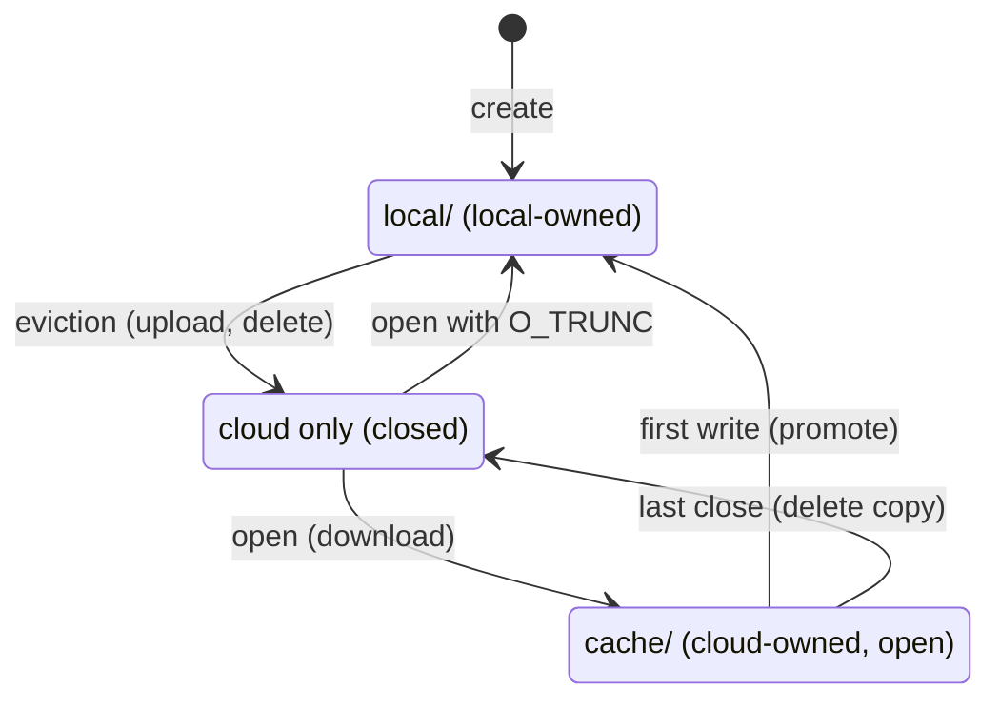

# Tiered Storage

Adds the `tiered_storage` component, which keeps data on local storage without backing it up to the cloud. When local usage gets high, the least recently used files are uploaded and deleted locally (evicted). Evicted files stay accessible: opening one downloads a temporary copy, which is discarded on close.

Full design: [DESIGN.md][design]. The "details" links below go to its sections.

## Principles

- **Simplicity over perfect correctness.** A small state machine; rare failures are logged, not recovered.
- **One authority per file, encoded in the on-disk layout.** No persisted metadata, so crash recovery needs none.
- **Fail early.** Cheap checks run before any change, and the hardest-to-undo step (the cloud) runs last.

Non-goals: protecting local-owned data from local disk loss, and sharing a bucket between mounts. ([details][non-goals])

## Layout and ownership

```text
<tiered_root>/local/   authoritative local files
<tiered_root>/cache/   disposable copies of open cloud files
```

A file is in at most one tree, and its location alone decides which copy is authoritative.



- Promotion is an atomic rename done before the write is acknowledged, so acknowledged writes always survive a crash.
- Startup deletes `cache/` and loads `local/` into the LRU by mtime. ([startup][startup], [crash recovery][crash])
- In-memory state is just per-file locks, the LRU, a size tracker, and the `cloudStale` hint below.

## Eviction and capacity

- Eviction runs only in the background: the LRU policy evicts from `high-threshold` down to `low-threshold`. Writes never wait for it. ([details][eviction])
- **Evict on close:** a file promoted from the cloud is marked `cloudStale` (in memory only). After its last close it is evicted regardless of thresholds, so the cloud does not keep serving outdated content. ([details][evict-on-close])
- There is no space reservation. `max-size-mb` only sets the thresholds; the hard limit is local free space, and `ENOSPC` is returned unchanged. ([details][capacity])

## Operations

- Delete and rename check `CloudConnected()` after taking locks and before changing anything, so they fail fast when offline. ([details][connectivity])
- `DeleteFile` deletes in the cloud first, so a stale copy can't resurface.
- `RenameFile` and `RenameDir` rename locally first (cheap to undo, and on Windows an open file fails it early with `EBUSY`), then in the cloud, reverting locally if the cloud fails. ([file][renamefile], [dir][renamedir])
- Permissions are not tracked: chmod and chown are ignored, and everything uses the default mode set at mount. ([details][permissions])
- Symlinks are local-only and never uploaded. ([details][dir-ops])

## Concurrency and platforms

- Per-file locks serialize open, release, promotion, delete, rename, and eviction. `RenameDir` relies on libfuse/WinFsp path locking for atomicity against operations beneath it. ([details][locking])
- On Windows, files are opened with `FILE_SHARE_DELETE`, so promotion and delete-while-open behave as on Linux with one code path. ([details][windows])

See also: [per-operation details][file-ops], [test plan][tests], [backlog][backlog].

[design]: https://github.com/Seagate/cloudfuse/blob/feature/tiered_storage/component/tiered_storage/DESIGN.md
[non-goals]: https://github.com/Seagate/cloudfuse/blob/feature/tiered_storage/component/tiered_storage/DESIGN.md#assumptions-and-non-goals
[startup]: https://github.com/Seagate/cloudfuse/blob/feature/tiered_storage/component/tiered_storage/DESIGN.md#startup
[crash]: https://github.com/Seagate/cloudfuse/blob/feature/tiered_storage/component/tiered_storage/DESIGN.md#crash-recovery
[eviction]: https://github.com/Seagate/cloudfuse/blob/feature/tiered_storage/component/tiered_storage/DESIGN.md#eviction
[evict-on-close]: https://github.com/Seagate/cloudfuse/blob/feature/tiered_storage/component/tiered_storage/DESIGN.md#evict-on-close
[capacity]: https://github.com/Seagate/cloudfuse/blob/feature/tiered_storage/component/tiered_storage/DESIGN.md#capacity-accounting
[connectivity]: https://github.com/Seagate/cloudfuse/blob/feature/tiered_storage/component/tiered_storage/DESIGN.md#cloud-connectivity-rule
[renamefile]: https://github.com/Seagate/cloudfuse/blob/feature/tiered_storage/component/tiered_storage/DESIGN.md#renamefile
[renamedir]: https://github.com/Seagate/cloudfuse/blob/feature/tiered_storage/component/tiered_storage/DESIGN.md#renamedir
[dir-ops]: https://github.com/Seagate/cloudfuse/blob/feature/tiered_storage/component/tiered_storage/DESIGN.md#directory-operations
[permissions]: https://github.com/Seagate/cloudfuse/blob/feature/tiered_storage/component/tiered_storage/DESIGN.md#permissions
[locking]: https://github.com/Seagate/cloudfuse/blob/feature/tiered_storage/component/tiered_storage/DESIGN.md#locking
[windows]: https://github.com/Seagate/cloudfuse/blob/feature/tiered_storage/component/tiered_storage/DESIGN.md#windows-semantics
[file-ops]: https://github.com/Seagate/cloudfuse/blob/feature/tiered_storage/component/tiered_storage/DESIGN.md#file-operations
[tests]: https://github.com/Seagate/cloudfuse/blob/feature/tiered_storage/component/tiered_storage/DESIGN.md#required-tests
[backlog]: https://github.com/Seagate/cloudfuse/blob/feature/tiered_storage/component/tiered_storage/DESIGN.md#backlog---do-not-implement
